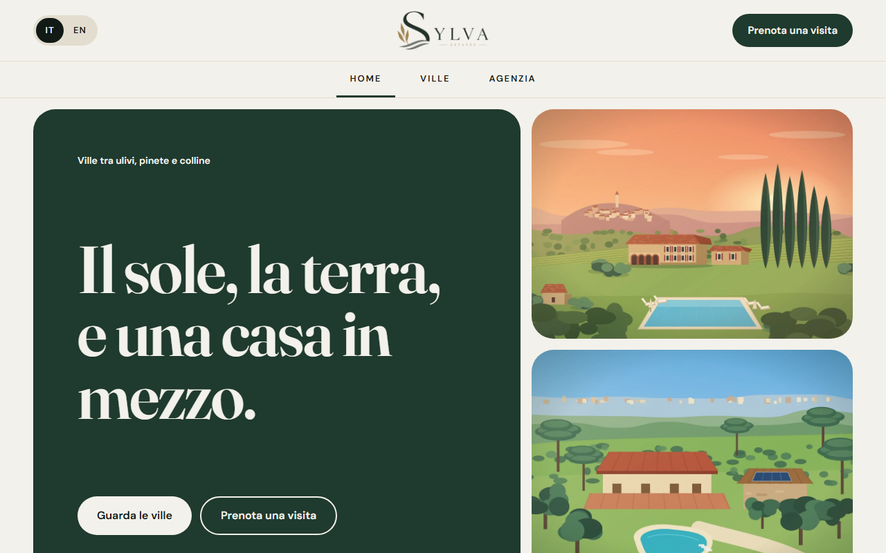
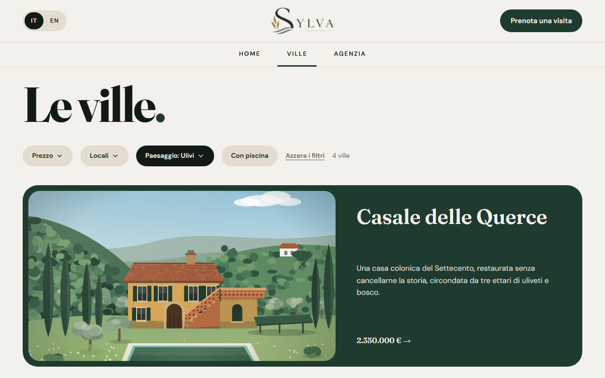
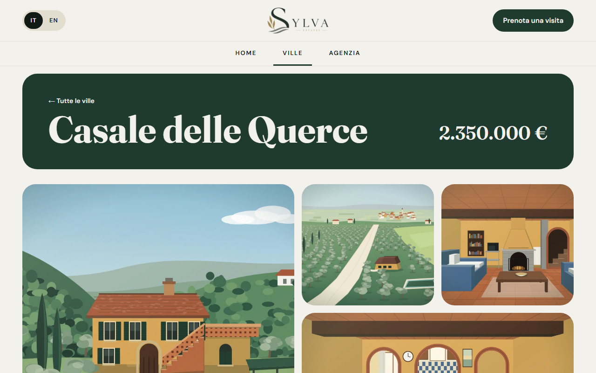
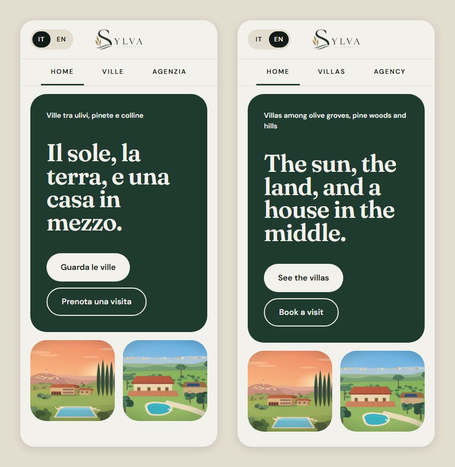

# Sylva Estates

Sito di un'agenzia immobiliare immaginaria che vende **ville immerse nella natura**: case coloniche, tenute, masserie e rifugi nel bosco. Ha quattro pagine (home, elenco filtrabile, scheda della villa e agenzia), in italiano e inglese, con uno stile sobrio «bosco notturno e ottone».



**Demo online:** il sito è pubblicato con GitHub Pages; il link è nella sezione *About* di questo repository.

> **Progetto dimostrativo.** L'agenzia non esiste: indirizzo, telefono, email e partita IVA sono segnaposto, e le ville, i prezzi e le descrizioni sono inventati. Non c'è un backend: i pulsanti «Prenota una visita» non inviano nulla e i recapiti sono solo testo.

## Funzionalità

- **Home** con la hero, il carosello infinito «Scopri le ville» (frecce su desktop, si striscia su mobile) e i tre territori (ulivi, mare, colline), ognuno con un link all'elenco già filtrato.
- **Elenco delle 14 ville** con filtri combinabili:
  - **prezzo** e **locali**, intervalli «Da / A» a scelta libera, precompilati con gli estremi reali dei dati e controllati prima di applicarli;
  - **paesaggio**, tendina a checkbox (uno o più);
  - **con piscina**.

  I filtri stanno nella query string (`/ville?paesaggio=ulivi&prezzoMax=2000000`), quindi si possono condividere e sopravvivono al tasto indietro.
- **Scheda della villa**: prezzo, galleria con le prime quattro foto, lightbox a schermo intero (frecce, tastiera, Esc; si striscia su mobile), tab «Panoramica» e «Spazi» con il pattern ARIA delle tab.
- **Agenzia**: presentazione, «Come lavoriamo» in cinque passaggi, cosa contiene ogni scheda, domande frequenti con `<details>` nativo e recapiti.
- **Italiano e inglese** con un selettore nell'header. La scelta resta salvata nel browser.
- **Responsive**, da 320px in su.
- **Accessibile**: contrasti WCAG AA per tutti i testi, foto con testo alternativo in entrambe le lingue, focus visibile, animazioni ridotte con «riduci movimento» attivo nel sistema.

| Elenco filtrato per paesaggio | Scheda della villa |
|---|---|
|  |  |




## Tecnologie

[React 19](https://react.dev) · [TypeScript](https://www.typescriptlang.org) · [Vite](https://vite.dev) · [React Router](https://reactrouter.com) · [Tailwind CSS 4](https://tailwindcss.com) · [i18next](https://www.i18next.com) · [Lucide](https://lucide.dev) · [oxlint](https://oxc.rs)

## Avvio

Serve [Node.js](https://nodejs.org) 20.19+ o 22.12+.

```bash
npm install
npm run dev      # server di sviluppo su http://localhost:5173
npm run build    # controllo dei tipi + build di produzione in dist/
npm run preview  # serve la build di produzione
npm run lint     # oxlint
```

Per aprire il sito direttamente in una lingua: `http://localhost:5173/?lng=en`.

## Come funziona

Non c'è un backend né una API simulata: le ville sono dati statici in `src/data/properties.ts` e tutto avviene nel browser.

- **Dati delle ville**: per ognuna nome, paesaggi, prezzo, superficie, locali, bagni, piscina, ettari di verde e sei foto. `rooms` sono i **locali**, non le camere: per questo la scheda mostra «Locali». Il paesaggio non si vede da nessuna parte: serve solo al filtro e ai link dei territori.
- **Filtri** (`src/data/filters.ts`, `src/useVillaFilters.ts`):
  - si combinano tra loro in AND; dentro il paesaggio basta uno dei valori scelti (OR);
  - gli estremi degli intervalli (`PRICE_BOUNDS`, `ROOMS_BOUNDS`) sono il minimo e il massimo dei dati, non fasce fisse: si aggiornano da soli se cambiano le ville;
  - un intervallo uguale agli estremi equivale a «nessun limite» e non finisce nell'URL;
  - prima di applicare, `RangeFilter` controlla che i campi non siano vuoti, che siano numeri e che «Da» non superi «A», e segna l'errore sul campo;
  - le scritture partono dall'URL attuale (`window.location.search`), così due modifiche ravvicinate non si cancellano a vicenda.
- **Carosello infinito** (`VillaCarousel`): le ville sono ripetute in tre copie (le due esterne nascoste ai lettori di schermo e fuori dall'ordine di tab). Arrivati al bordo della copia centrale, si salta senza animazione alla stessa card nella copia vicina.
- **Foto** (`src/data/photos.ts`): nei dati si scrive solo il nome del file (`casa-1.1.webp`), Vite le trova con `import.meta.glob`. Hero, territori e agenzia indicano a mano la casa e la foto da usare (`data/home.ts`, `data/agency.ts`); se una foto non c'è più, il riquadro sparisce invece di rompere la pagina.
- **Scroll**: a ogni cambio di pagina si riparte dall'alto, anche con avanti e indietro; i filtri cambiano solo la query string e non spostano la pagina. Un'ancora nell'URL (`/agenzia#domande`) porta alla sezione, lasciando lo spazio per l'header sticky.
- **Pagine sconosciute**: ogni percorso che non esiste torna alla home; una villa che non esiste torna all'elenco.

## Struttura

```
src/
  main.tsx                 punto di ingresso: stile, i18n, router e App
  App.tsx                  rotte: /, /ville, /ville/:slug, /agenzia
  SylvaLayout.tsx          header, pagina, footer; scroll a ogni cambio di pagina
  routes.ts                percorsi usati dai link
  sylva.css                Tailwind con il tema (palette, font, breakpoint tablet/mobile)
  useVillaFilters.ts       filtri nella query string
  assets/
    header-logo.webp       logo nell'header
    foto/                  84 foto, sei per villa (casa-N.M.webp)
  components/
    SylvaHeader.tsx        selettore di lingua, logo, prenotazione e nav
    SylvaFooter.tsx        recapiti
    LanguageSwitch.tsx     selettore IT/EN
    VillaCarousel.tsx, VillaCardScroll.tsx, TerritoryRow.tsx, ClosingBand.tsx   home
    VillaCardRow.tsx, VillaFilters.tsx, RangeFilter.tsx, LandscapeFilter.tsx    elenco
    Gallery.tsx, Lightbox.tsx, Tabs.tsx, FactCard.tsx, VisitAside.tsx           scheda
    FakeButton.tsx, Photo.tsx
  data/
    properties.ts          le 14 ville
    filters.ts             estremi degli intervalli e regola dei filtri
    format.ts              prezzi, m² ed ettari nella lingua attiva
    photos.ts              URL delle foto, foto scelte a mano, testi delle ville
    home.ts, agency.ts     foto scelte per home e agenzia
    site.ts                nome e recapiti (fittizi)
  i18n/
    index.ts               configurazione di i18next
    locale.ts              lingua attiva, locale per Intl, helper per i testi
  locales/
    it.json, en.json       tutti i testi del sito
  portfolio/               pillola «torna al portfolio», solo per chi arriva da flowsi.it
  pages/
    SylvaHome.tsx, SylvaListings.tsx, SylvaProperty.tsx, SylvaAgency.tsx
public/favicon.webp        icona del sito
docs/screenshots/          immagini di questo README
.github/workflows/deploy.yml   pubblicazione automatica su GitHub Pages
```

Nome e recapiti dell'agenzia stanno solo in `src/data/site.ts`: header, footer e pagina Agenzia li leggono da lì.

## Arrivo dal portfolio

La demo fa parte del portfolio [flowsi.it](https://flowsi.it), che la apre con il parametro `?from=portfolio`. Solo in quel caso, in alto a sinistra, compare una pillola fissa che riporta al portfolio (`src/portfolio/`). Chi arriva da GitHub o da un link diretto non la vede.

- `fromPortfolio.ts`, importato in `main.tsx` prima del render, salva il segnale nel `sessionStorage` (chiave `portfolio:back`) e toglie `from` dall'URL. Così la pillola resta navigando tra le pagine della scheda, ma un link copiato non la porta con sé. Mette anche l'attributo `data-portfolio-back` su `<html>`.
- `BackToPortfolio.tsx` è la pillola, con i testi IT/EN al suo interno. Riporta sempre a `https://flowsi.it/#progetti`: l'indirizzo è fisso nel codice e non letto dall'URL, così nessuno può usarla per mandare altrove.
- Le classi con la variante `back:` (definita nel foglio di stile) valgono solo con quell'attributo: nell'header lasciano spazio alla pillola.

## Pubblicazione su GitHub Pages

Il workflow `.github/workflows/deploy.yml` pubblica il sito a ogni push sul branch `main`. Si può anche avviare a mano dalla scheda *Actions*. Il workflow installa le dipendenze, esegue il build e carica la cartella `dist/` su GitHub Pages.

Il sito viene servito da un sottopercorso, `https://<utente>.github.io/<nome-repository>/`. Per questo:

- il build riceve quel percorso come `base` (`--base=/<nome-repository>/`), letto dal nome del repository: se il repository viene rinominato, il workflow continua a funzionare;
- il router usa lo stesso percorso come `basename` (`import.meta.env.BASE_URL` in `main.tsx`);
- dopo il build, `dist/index.html` viene copiato in `dist/404.html`. GitHub Pages risponde con quella pagina a ogni percorso che non è un file, come `/sylva-estates/ville/villa-glicine`: così anche un link diretto o un ricaricamento su una scheda aprono la pagina giusta.

Configurazione, una sola volta: *Settings → Pages → Build and deployment → Source: **GitHub Actions***.

## Lingua

La lingua viene scelta in quest'ordine: il parametro `?lng=it` / `?lng=en` nell'URL, poi la scelta fatta con il selettore (salvata nel `localStorage` alla chiave `sylva-estates:lang`), infine la lingua del browser. Se nessuna corrisponde, il sito è in italiano. Quando si cambia lingua con il selettore, un eventuale `?lng=` viene tolto dall'URL.

I testi stanno in `src/locales/it.json` e `src/locales/en.json` (namespace `sylva`), con la stessa struttura di chiavi. `data/properties.ts` contiene solo i dati: sommario e descrizione di ogni villa sono alla chiave `properties.<slug>`, la didascalia di ogni foto in `photos.<casa-N-M>`. I nomi delle ville sono nomi propri e restano uguali. Prezzi e numeri sono formattati con `Intl`; l'inglese usa `en-GB`, con l'euro (`€2,350,000`). Slug, URL e parametri dei filtri (`?paesaggio=ulivi`) restano italiani in tutte le lingue.

La lingua si può cambiare in qualsiasi momento, quindi nessun testo o formattatore viene calcolato una volta sola all'avvio: si legge la lingua al momento della chiamata (`currentLocale()`, `translate()`, `useLang()` in `src/i18n/locale.ts`).

Il tono è quello di un'agenzia che dice «noi» e dà del «tu» al cliente. In inglese i contenuti legati all'Italia (rogito, notaio) sono adattati, non tradotti alla lettera.

## Design

### Direzione visiva

Un'agenzia di fascia alta che lascia parlare le foto: fondo color pietra, grandi blocchi verde bosco, titoli serif molto grandi con un punto verde finale, pulsanti e filtri a pillola. Le forme sono poche e ripetute:

- pillole (`999px`) per pulsanti, badge, tab e selettore di lingua;
- blocchi grandi (hero, fasce, card dell'elenco) a `32px`, card medie a `28px`, card piccole a `20px`;
- margine laterale di `48px` (`20px` sotto i 640px); nella home le sezioni sono separate da `112px`.

Niente gradienti e quasi nessuna ombra o animazione: l'hover dei link e dei pulsanti, le card «Cosa trovi in ogni scheda» che si sollevano, lo scorrimento del carosello. Con «riduci movimento» attivo il carosello salta senza animazione.

Il riferimento è il desktop a 1440px. `tablet:` (≤1024px) e `mobile:` (≤640px) sono `@custom-variant` di `sylva.css`: sotto i 1024px i titoli scendono con `clamp()` e le righe vanno in colonna; sotto i 640px il pulsante di prenotazione dell'header sparisce, la nav scorre in orizzontale e la galleria passa a due colonne.

### Palette «Bosco notturno e ottone» (`sylva.css`)

I colori sono definiti solo in `:root` di `sylva.css` e le utility li leggono con `@theme inline` (`bg-verde-bosco` → `var(--verde-bosco)`). La palette di Tailwind è azzerata: un `bg-white` scritto per sbaglio non produce stile.

| Token | Valore | Uso |
|---|---|---|
| `pietra-chiara` | `#F3F1EB` | fondo pagina, testo su fondi scuri |
| `verde-bosco` | `#1F3A2E` | colore primario: hero, card, pulsanti, voce attiva, link |
| `verde-notte` | `#142A20` | hover dei link e dei pulsanti verdi |
| `nero-bosco` | `#111A15` | testo principale, sezioni scure, pulsanti scuri, lingua attiva |
| `pietra` | `#E2DDCF` | card alternate, barra delle tab, selettore di lingua, bordi |
| `ottone` | `#B89A5E` | pulsanti su fondo scuro (testo nero-bosco), anello di focus |
| `grafite` | `#373D38` | paragrafi |
| `muschio-grigio` | `#5B5F58` | testi secondari e metadati |
| `salvia-chiara` | `#D8DAD2` | testo secondario su fondi scuri |
| `pietra-scura` | `#CCC8B8` | fondo delle foto mentre si caricano |
| `bianco` | `#FFFFFF` | card bianche |

Contrasti WCAG 2.x, misurati:

| Testo | Fondo | Contrasto |
|---|---|---|
| nero-bosco | pietra-chiara / pietra / bianco | 15,72 / 13,09 / 17,76 |
| nero-bosco | ottone | 6,62 |
| pietra-chiara | nero-bosco / verde-bosco | 15,72 / 10,92 |
| grafite | pietra-chiara / pietra / bianco | 9,85 / 8,20 / 11,13 |
| muschio-grigio | pietra-chiara / pietra / bianco | 5,77 / 4,80 / 6,52 |
| salvia-chiara | nero-bosco | 12,58 |
| verde-bosco | pietra-chiara / bianco | 10,92 / 12,33 |
| errore `#B3261E` | bianco | 6,54 |

L'ottone arriva solo a 2,38 sulla pietra-chiara: per questo non si usa mai per il testo su fondi chiari. L'anello di focus in ottone (`2px`, a `3px` dal bordo) sui fondi chiari resta sotto il 3:1 richiesto per gli elementi grafici: è un limite noto della palette.

### Font

- `font-display`: **Fraunces** (`@fontsource-variable/fraunces/opsz.css`, asse `opsz` automatico) per titoli, nomi delle ville, prezzi e numeri grandi.
- `font-sans`: **DM Sans** (`@fontsource-variable/dm-sans`) per tutto il resto.

## Licenza

Distribuito con licenza [MIT](LICENSE).
